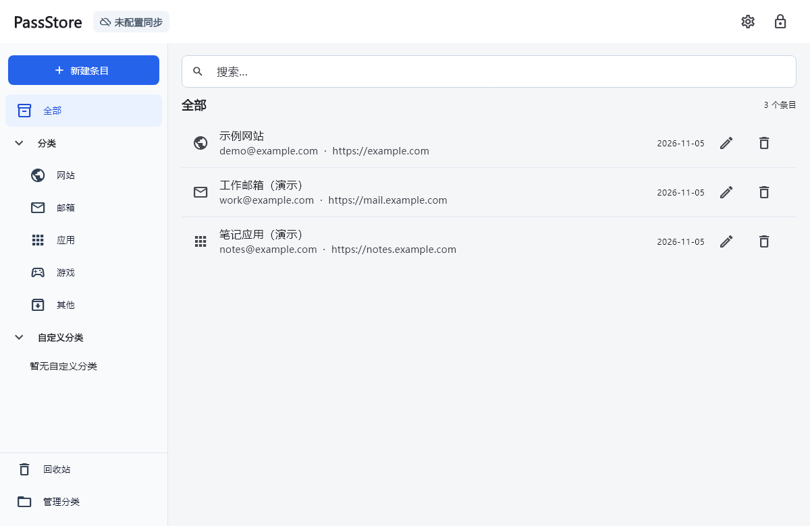
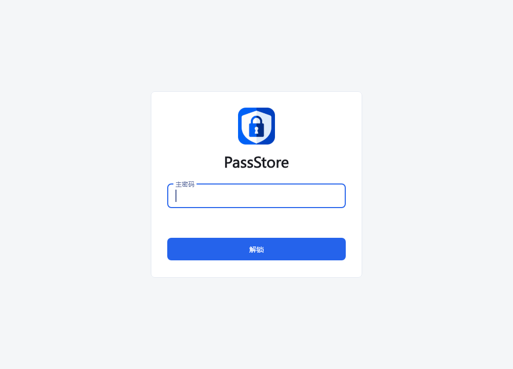
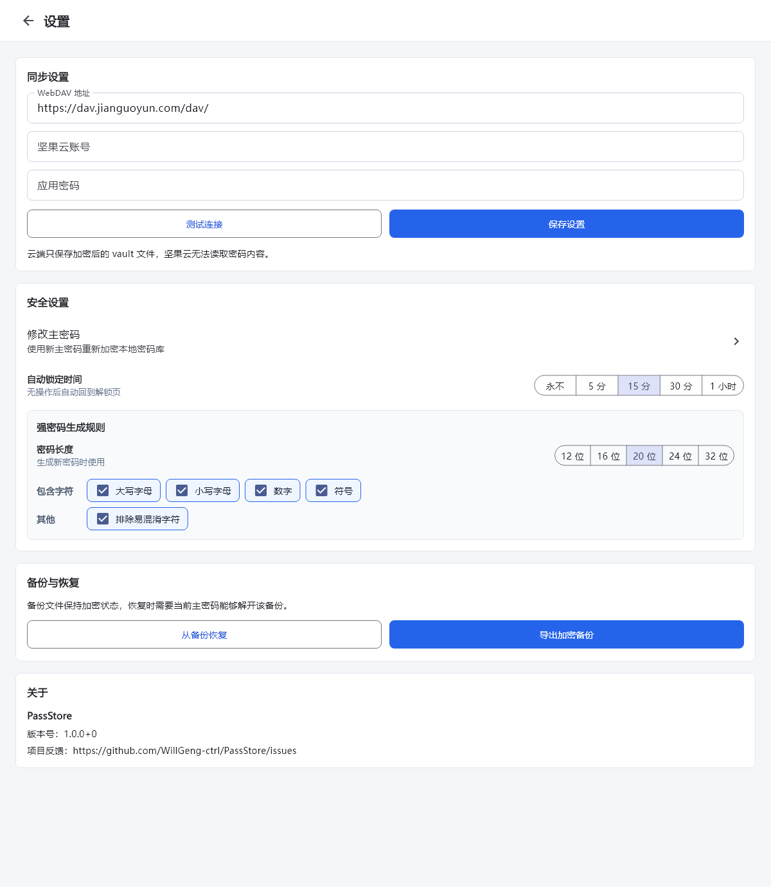

# PassStore

面向 Windows 与 macOS 的个人密码管理器。密码保存在本机加密密码库中，可选择通过自己的 WebDAV 存储同步。

[功能](#功能) · [截图](#截图) · [安装与运行](#安装与运行) · [安全设计](#安全设计) · [测试](#测试) · [Roadmap](#roadmap) · [开发计划](docs/DEVELOPMENT.md)

## 项目状态

- 当前源码版本：`1.0.0+0`，处于桌面开发与发布准备阶段。
- 仓库包含 Windows、macOS 工程，以 Windows 为当前验证重点；macOS 部分流程尚未补齐。尚未提供移动端、Linux 或 Web 工程。
- 当前没有 GitHub Release 安装包，使用方式为从源码运行或自行构建。
- 本地功能不需要注册账号；WebDAV 同步由用户自行配置。历史商业化设计不代表已经提供付费、账号或移动端功能。

## 功能

| 功能 | 当前能力 |
| --- | --- |
| 本地密码库 | 创建、主密码解锁、手动锁定、更换主密码 |
| 条目管理 | 保存标题、账号、密码、网址和备注；新增、编辑、删除 |
| 分类与搜索 | 内置分类、自定义分类，按标题、账号和网址搜索 |
| 回收站 | 恢复已删除条目，或永久删除 |
| 密码生成 | 配置长度、大小写、数字、符号及易混淆字符选项 |
| 剪贴板 | 复制字段，默认 30 秒后在内容仍相同时清除 |
| 自动锁定 | 默认 15 分钟，可在设置中调整 |
| 加密备份 | Windows 导出与恢复；macOS 当前仅导出至 Documents，恢复入口尚未接通 |
| WebDAV 同步 | 连接测试、手动同步、修改后延迟自动同步、合并与冲突处理 |

同步先读取并解密远端密码库，再结合本地同步基线合并；远端提供 ETag 时，上传携带 `If-Match`，避免覆盖读取后发生的远端修改。首次创建远端文件使用 `If-None-Match: *`。

## 截图

以下截图由当前 Flutter 页面渲染，使用独立的虚构演示数据，不读取个人密码库，也不连接真实 WebDAV 服务。

### 密码库



### 解锁



### 设置



截图生成方法见 [截图说明](docs/screenshots/README.md)。

## 安装与运行

### 环境准备

1. 安装 [Flutter SDK](https://docs.flutter.dev/install/manual) 并将 `flutter` 加入 `PATH`。SDK 内置 Dart，需满足项目的 `>=3.11.0 <4.0.0` 约束。
2. Windows：安装 Visual Studio 的 **Desktop development with C++** 工作负载及 Windows SDK，参考 [Flutter Windows 环境说明](https://docs.flutter.dev/platform-integration/windows/setup)。Visual Studio Code 编辑器不能替代此编译工具链。
3. macOS：在 macOS 上安装 Xcode，并按 [Flutter macOS 环境说明](https://docs.flutter.dev/platform-integration/macos/setup) 配置编译工具。
4. 运行 `flutter doctor -v`，处理目标桌面平台的环境问题。

本轮验证使用 Flutter **3.47.9** / Dart **3.13.7**。建议先使用该版本复现；其他满足 SDK 约束的版本需运行相同检查。

### 获取源码

```sh
git clone https://github.com/WillGeng-ctrl/PassStore.git
cd PassStore
flutter pub get
flutter devices
```

### Windows

```powershell
flutter run -d windows
flutter build windows --release
```

默认 x64 构建输出位于 `build/windows/x64/runner/Release/`。分发时保留整个目录，包括 `PassStore.exe`、Flutter DLL 和 `data/`，不要只复制 exe。

### macOS

在 macOS 上执行：

```sh
flutter run -d macos
flutter build macos --release
```

应用输出位于 `build/macos/Build/Products/Release/`。签名、公证和安装包制作仍在发布计划中；Windows 无法验证 macOS 原生构建。

## 首次使用

1. 创建密码库并设置主密码。应用没有主密码找回服务。
2. 添加条目，按需要创建自定义分类或使用搜索。
3. 导出一次加密备份，确认能使用对应主密码恢复。
4. 如需同步，在设置中填写 WebDAV 地址、账号及第三方应用密码，测试连接并保存，再点击主界面同步状态。

坚果云默认地址为 `https://dav.jianguoyun.com/dav/`。填写注册邮箱及第三方应用密码；远端文件位于该 WebDAV 集合下的 `PassStore/passstore.vault`。其他服务需要支持 `PROPFIND`、`GET`、`MKCOL`、`PUT` 及相应条件请求。

同步不是独立备份：删除和编辑也可能同步到其他设备，应另行保留加密备份。当前恢复流程使用已解锁密码库的主密码，因此该密码必须能解开备份；更换主密码前后生成的备份可能使用不同密码。macOS 的文件选择与备份恢复尚未实现。

## 安全设计

### 密码库加密

- 使用 `cryptography` 包的 **Argon2id** 从主密码和随机 16 字节 salt 派生 32 字节密钥。
- 当前参数为 `memory: 19456`、`iterations: 2`、`parallelism: 1`、`hashLength: 32`，定义在 [vault_crypto.dart](lib/core/services/vault_crypto.dart)。
- 使用 **AES-256-GCM** 加密整个密码库并验证认证标签。文件保存格式版本、salt、nonce、认证标签及密文，不保存主密码。
- 条目及 WebDAV 应用密码保存在加密内容中。主密码和解锁后的条目在使用期间存在于进程内存中；Dart 字符串不提供可靠的内存擦除保证。

### 本地文件

| 系统 | 默认目录 |
| --- | --- |
| Windows | `%APPDATA%\PassStore\` |
| macOS | `~/Library/Application Support/PassStore/` |
| 无对应环境变量时 | 当前工作目录下的 `.passstore/` |

| 文件 | 内容 |
| --- | --- |
| `passstore.vault` | 加密密码库 |
| `settings.json` | WebDAV 地址、账号和是否配置应用密码等元数据；这些字段未加密 |
| `preferences.json` | 自动锁定、剪贴板计时与密码生成规则 |
| `sync_metadata.json` | 加密同步基线、远端版本信息、同步时间和错误状态 |

旧版明文 WebDAV 应用密码会在创建或解锁密码库时迁移到加密密码库，并重写设置文件。操作系统用户目录本身的访问控制仍然重要。

### 同步与使用边界

- 上传的是加密密码库；连接 WebDAV 时仍需要使用账号及应用密码。请使用 **HTTPS**，当前客户端没有强制拒绝 HTTP 地址。
- 默认提供自动锁定和剪贴板延迟清除。系统剪贴板历史、其他程序已读取的数据不受应用控制。
- 条目编辑窗口目前默认显示密码明文，使用时需留意屏幕共享和周围环境。
- 当前本地写入尚未采用临时文件加原子替换；文件格式版本、KDF 参数迁移、损坏恢复和异常中断验证列入下一阶段计划。
- 项目尚未经过独立安全审计。待办及验收标准见 [开发计划](docs/DEVELOPMENT.md)。

## 测试

```sh
flutter pub get
flutter analyze
flutter test
```

测试包含密码加解密、错误主密码、分类与回收站、字段合并、WebDAV 协议请求、应用密码存储、加密备份和界面交互。WebDAV 自动化测试使用 mock，不需要填写真实账号。

分层命令、覆盖范围、手工清单与验证记录见 [测试说明](docs/TESTING.md)。

## Roadmap

- [x] 桌面密码库、分类搜索、回收站和密码生成。
- [x] AES-GCM 加密、Argon2id 密钥派生和加密备份。
- [x] WebDAV 同步、同步基线与主密码变更流程。
- [x] MIT 许可、项目说明及演示截图。
- [ ] P1：原子写入、文件格式校验、损坏恢复与 KDF 兼容方案。
- [ ] P2：同步竞态、网络超时、HTTPS 策略、离线恢复及真实服务联调。
- [ ] P3：键盘与生命周期锁定验证、默认密码遮挡及桌面可用性改进。
- [ ] P4：持续集成、Windows/macOS 构建验证、签名及首个 Release。
- [ ] 后续评估：移动端、系统凭据/生物识别集成和更多同步方式。

按 P1 → P4 顺序推进，每阶段达到验收条件后再进入下一阶段。移动端及历史商业化方案不作为当前已实现能力或发布日期承诺。详见 [实际开发计划](docs/DEVELOPMENT.md)。

## 项目结构

```text
lib/core/          数据模型、加密、合并和密码生成
lib/data/          本地持久化、偏好设置、备份与 WebDAV
lib/features/      桌面页面、弹窗和应用交互
test/              核心、数据与界面自动化测试
tool/              文档截图生成工具
docs/              开发计划、测试说明、截图与历史设计文档
windows/ macos/    桌面原生工程
```

## 反馈与许可

功能问题和建议请提交至 [GitHub Issues](https://github.com/WillGeng-ctrl/PassStore/issues)。请使用演示数据，移除账号、密码库、WebDAV 应用密码和含个人信息的日志。

本项目采用 [MIT License](LICENSE)，允许使用、修改和分发，需保留许可及版权声明。第三方依赖和字体等资源适用各自许可。
