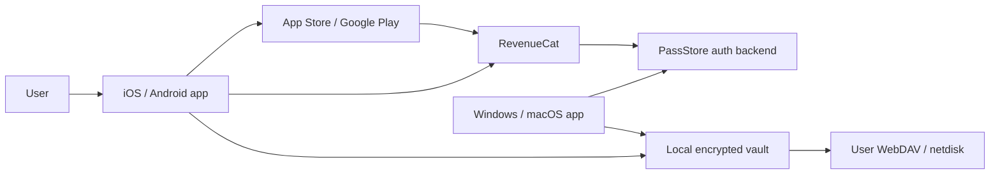

# PassStore Commercialization and Cross-Platform Authorization Design

Date: 2026-05-12
Status: discussion handoff, approved direction with several follow-up decisions

## Goal

PassStore will become a simple personal password manager with paid Pro unlock across Windows, macOS, iOS, and Android. Password data must remain under the user's control: local encrypted vault plus user-owned sync storage such as WebDAV/netdisk. PassStore should not run its own password cloud.

## Decisions Already Agreed

- Target user: personal heavy users who want a simple multi-device password vault.
- Product model: Free + Pro.
- Pro price: launch price CNY 18.
- Pro type: all-platform lifetime unlock, not subscription.
- Password data sync: user-owned storage only, not PassStore-hosted cloud storage.
- Backend is acceptable only for lightweight account, authorization, and purchase verification.
- Payment direction: use Apple App Store / Google Play purchase flows where the mobile apps are distributed through those stores.
- First commercial implementation should not make the app complicated. Keep the existing easy desktop UX as the base.

## Product Boundary

### Free

Recommended free scope:

- Local encrypted password vault.
- Default categories and custom categories.
- Manual encrypted backup export and restore.
- Strong password generation can remain available, because it is a basic password-manager expectation.

### Pro

Recommended Pro scope:

- Cross-device use under the same PassStore account.
- WebDAV/netdisk sync across devices.
- Mobile app access.
- Future advanced sync providers if added.

Reasoning: the paid value should be "I can safely use this across all my devices", not "basic password management is locked away". This keeps the product easy to trust.

This boundary is still a product decision. If the first paid version wants maximum goodwill, WebDAV sync can remain free on desktop, and Pro can unlock mobile + all-platform authorization instead.

## Platform Strategy

### Windows

- Distribution: direct download first.
- Payment: no Windows payment flow in phase one.
- Unlock: user logs in with PassStore account and receives Pro entitlement if already purchased on iOS or Android.

### macOS

- Distribution: direct download first, Mac App Store later only if needed.
- Payment: no macOS payment flow in phase one unless shipping through Mac App Store.
- Unlock: same as Windows.

### iOS

- Distribution: App Store.
- Payment: App Store in-app purchase.
- Product type: non-consumable lifetime product, for example `passstore_pro_lifetime`.
- Restore purchase must be available.

Apple's guideline for multi-platform services allows users to access features bought elsewhere, but those features must also be available as in-app purchases inside the app. See references.

### Android

- Distribution: Google Play for the international version.
- Payment: Google Play Billing one-time product.
- Product type: managed one-time product, for example `passstore_pro_lifetime`.
- Restore/check purchase must be available.

Google Play-distributed apps that sell in-app digital features normally need to use Google Play's billing system, with regional exceptions. See references.

### Mainland China Android

Google Play is not a good primary channel for mainland users. Defer this to a later decision.

Options:

- Ship Android first through Google Play only, then add China Android stores later.
- Add Huawei/Xiaomi/Oppo/Vivo app store builds later, each with its own payment/review rules.
- Add official website download plus activation code later, but this reintroduces a payment channel outside the app stores.

Recommendation: do not block the first commercial design on mainland Android distribution. Finish iOS + Google Play + desktop entitlement first.

## Recommended Architecture

Use RevenueCat for App Store / Google Play receipt verification and entitlement management, plus a tiny PassStore authorization backend for account login and desktop entitlement lookup.

Important separation:

- RevenueCat verifies purchases and tracks entitlement.
- PassStore backend maps an email account to a RevenueCat user and signs desktop authorization tokens.
- PassStore backend never stores the password vault, master password, WebDAV password, or decrypted password entries.
- Password data sync continues to use the user's own WebDAV/netdisk.

## Why a Backend Is Still Needed

Apple and Google can verify a purchase on mobile, but Windows and direct-download macOS cannot automatically know that the same human bought Pro on iOS or Android.

Without a backend/account, the alternatives are weaker:

- Separate purchase per platform: simple technically, bad user experience.
- Manual activation codes: cheap, but easy to share and awkward to support.
- Local signed license file only: no automatic App Store / Google Play purchase-to-desktop bridge.

The minimum clean solution is an authorization account.

## Account Design

Use email verification code login.

- No account password.
- No social login in the first version.
- Free users can use the app without login.
- Login is required only for Pro unlock across devices.
- Store only authorization data.

Suggested backend fields:

- `user_id`
- `email`
- `email_verified_at`
- `revenuecat_app_user_id`
- `entitlement`
- `entitlement_status`
- `entitlement_source`
- `last_verified_at`
- `created_at`
- `updated_at`

Do not store:

- master password
- vault encryption key
- encrypted vault file
- WebDAV account/password
- password entries

## Authorization Token

The backend should issue a signed entitlement token to desktop apps after login.

Recommended token format:

- Signed JSON or JWT.
- Ed25519 signature preferred.
- App embeds only the public key.
- Backend keeps the private signing key.
- Token contains `user_id`, `email`, `entitlement`, `issued_at`, and `expires_at`.

Recommended offline behavior:

- Cache the signed token locally.
- Pro remains usable offline until token expiry.
- Start with 90-day expiry for a lifetime purchase.
- Refresh automatically when online.
- If a refund or revocation happens, remove Pro on the next successful refresh.

This is a product tradeoff: shorter expiry handles refunds faster; longer expiry is more user-friendly.

## Backend Provider

Recommended first choice: Cloudflare Workers + D1.

Why:

- Small operational surface.
- Good fit for email-code login and entitlement lookup.
- Free tier is likely enough for early development and small launch traffic, but pricing must be rechecked before release.
- No server maintenance.

Suggested endpoints:

- `POST /auth/request-code`
- `POST /auth/verify-code`
- `GET /entitlement`
- `POST /entitlement/refresh`
- `POST /webhooks/revenuecat`

The RevenueCat webhook endpoint updates the user's entitlement when purchases, restores, refunds, or revocations happen.

## RevenueCat Role

Use RevenueCat to avoid writing separate receipt-verification code for App Store and Google Play.

Recommended RevenueCat setup:

- Entitlement: `passstore_pro`
- iOS product: `passstore_pro_lifetime`
- Android product: `passstore_pro_lifetime`
- Use the same PassStore `user_id` as RevenueCat `appUserID`.
- iOS/Android Flutter apps initialize RevenueCat with their platform-specific public SDK keys.

Desktop note:

- Desktop should not contain RevenueCat secret API keys.
- Desktop should ask the PassStore backend for entitlement state instead.

## User Flows

### Buy on iOS, unlock desktop

1. User opens PassStore iOS.
2. User logs in with email verification code.
3. User buys Pro through App Store in-app purchase.
4. RevenueCat verifies the purchase and marks `passstore_pro` active.
5. PassStore backend receives RevenueCat webhook or refreshes entitlement by API.
6. User opens Windows/macOS app.
7. User logs in with the same email.
8. Desktop receives signed Pro token and unlocks Pro.

### Buy on Android, unlock desktop

Same as iOS, but purchase happens through Google Play Billing.

### Restore purchase on mobile

1. User logs in with email.
2. User taps Restore Purchase.
3. RevenueCat restores/checks the store purchase.
4. Backend updates entitlement.
5. App unlocks Pro.

### No account

- App remains usable as Free.
- User can still use local vault features.
- Pro unlock requires login.

## Sync Model

Commercialization does not change the vault sync principle.

- Vault remains encrypted locally with the master password.
- Remote storage contains only encrypted vault files.
- WebDAV credentials are stored inside the encrypted vault.
- PassStore backend does not participate in password-data sync.
- Sync conflict rules remain part of the app/vault layer, not the licensing layer.

## Security Notes

- Paid authorization is not the security boundary for passwords.
- Vault encryption remains the security boundary.
- A cracked Pro check must not expose passwords; it only affects paid feature access.
- Never put backend signing keys, RevenueCat secret keys, or email provider API keys in the Flutter client.
- Store App Store / Google Play product IDs in client code; these are not secrets.

## Open Decisions For Next Discussion

1. Exact Free vs Pro feature boundary.
2. Whether WebDAV sync is Pro-only or remains free on desktop.
3. Whether desktop login should be optional until the user clicks Pro features, or shown in Settings only.
4. Offline entitlement expiry: 30, 90, or 180 days.
5. Device limit: no limit first, or soft limit such as 5 active devices.
6. Mainland China Android distribution strategy.
7. Whether macOS should stay direct-download first or go through Mac App Store.
8. Whether to use Cloudflare Email Routing, Resend, Aliyun email, or another provider for verification codes.

## Recommended Build Order

1. Add a local Pro entitlement model in the Flutter app without real payment.
2. Add Pro-gated UI states and make sure Free remains pleasant.
3. Build Cloudflare Worker auth backend with email-code login and D1 storage.
4. Add signed entitlement token generation and desktop token verification.
5. Set up RevenueCat project, entitlement, and test products.
6. Implement iOS RevenueCat purchase/restore flow.
7. Implement Android RevenueCat purchase/restore flow.
8. Connect RevenueCat webhooks to the PassStore backend.
9. Add Windows/macOS login + entitlement refresh UI.
10. Package and sign Windows/macOS builds.
11. Prepare App Store / Google Play listings and review notes.

## Release Positioning

Suggested wording:

PassStore is a simple personal password vault. Your passwords stay in your own encrypted vault. Sync uses your own WebDAV or netdisk storage. PassStore Pro unlocks all-platform use without requiring PassStore to host your password data.

Avoid promising "unbreakable" security. Say "local encryption" and "zero password-data hosting" instead.

## References Checked On 2026-05-12

- Apple App Review Guidelines, section 3.1.3(b), multi-platform services: https://developer.apple.com/app-store/review/guidelines/
- Google Play Payments policy: https://support.google.com/googleplay/android-developer/answer/9858738
- Google Play Payments policy FAQ, including alternate distribution and billing explanations: https://support.google.com/googleplay/android-developer/answer/10281818
- RevenueCat Flutter SDK installation and platform notes: https://www.revenuecat.com/docs/getting-started/installation/flutter
- RevenueCat SDK configuration and `appUserID` guidance: https://www.revenuecat.com/docs/getting-started/configuring-sdk
- RevenueCat pricing page: https://www.revenuecat.com/pricing/
- Cloudflare Workers pricing: https://developers.cloudflare.com/workers/platform/pricing/
- Cloudflare D1 pricing: https://developers.cloudflare.com/d1/platform/pricing/
